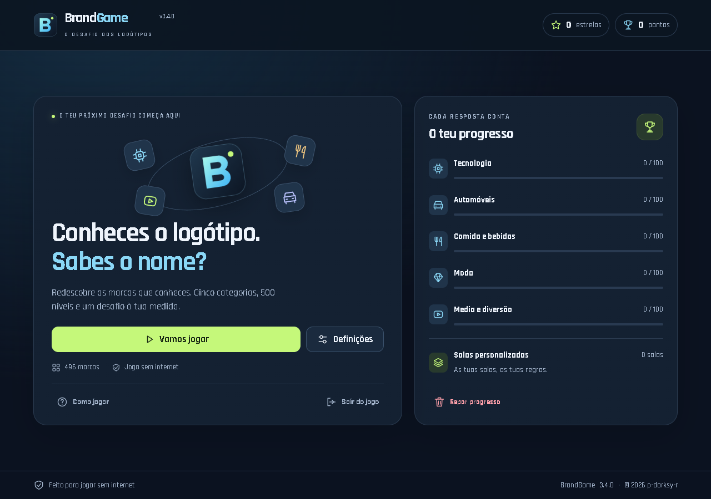

<!-- Copyright (c) 2026 p-darksy-r. BrandGame. -->
# BrandGame

Reconhece o logótipo e escreve o nome da marca antes de o tempo acabar. Joga offline com 496 marcas em cinco categorias, conquista estrelas e cria salas para desafiar outros jogadores no mesmo dispositivo.

**Versão 3.4.0 · 20 de novembro de 2026**



## Jogar

- **Windows x64.** Extrai o pacote [BrandGame-3.4.0-win-x64.zip](https://github.com/p-darksy-r/BrandGame/releases/download/v3.4.0/BrandGame-3.4.0-win-x64.zip) e abre `app/BrandGame.exe`. Mantém `app/web` junto do executável. O runtime .NET vem incluído. A janela usa o [Microsoft Edge WebView2 Runtime](https://developer.microsoft.com/microsoft-edge/webview2/).
- **Navegador.** Extrai o pacote [BrandGame-3.4.0-web.zip](https://github.com/p-darksy-r/BrandGame/releases/download/v3.4.0/BrandGame-3.4.0-web.zip) e abre `web/index.html`. O progresso fica nesse navegador.
- **Quem tem a versão 3.3.0.** Fecha o jogo e o atualizador. Substitui o `update.exe` ao lado da tua pasta `app` pelo [lançador 3.4.0](https://github.com/p-darksy-r/BrandGame/releases/download/v3.4.0/update.exe) e abre-o. Esta troca é necessária uma vez porque o lançador antigo só reconhece o endereço anterior dos downloads.

O jogo e o atualizador usam o certificado de desenvolvimento **BrandGame Development, O=p-darksy-r**. O Windows pode bloquear estes executáveis. Nesse caso, o pacote web permite jogar com as proteções do computador ativas. Consulta as [instruções para jogar](docs/PLAYTEST.md) e a [validação Windows](docs/VALIDATION.md).

## Novidades da versão 3.4.0

- Interface redesenhada com cartões de progresso, navegação mais clara, logótipo próprio e ícones vetoriais locais nos botões.
- Menus e 496 pistas em português de Portugal, inglês e espanhol. As salas conservam as pistas escritas pelo jogador.
- Quatro temas persistentes: Meia-noite, Claro, Floresta e Ametista. O menu, os controlos e os ecrãs de jogo acompanham a escolha.
- Janela Windows redimensionável e maximizável; layout adaptável, foco de teclado visível e ajuda com regras, pistas e atalhos.
- Autoria do projeto identificada como **p-darksy-r**, incluindo metadados dos executáveis e avisos das fontes. Os créditos de terceiros são preservados.

Mantém as atualizações online autenticadas, os recursos offline, as estrelas e os recordes por nível/dificuldade. Os saves anteriores conservam pontos, níveis, salas e resultados conhecidos; língua e tema recebem valores predefinidos quando ainda não existiam.

## Mudança de nome

O projeto e o repositório passam a chamar-se **BrandGame**. A aplicação migra o progresso para `%APPDATA%/BrandGame/save.json` e o perfil WebView2 para `%LOCALAPPDATA%/BrandGame/WebView2`, preservando os dados antigos. No navegador, a chave antiga do armazenamento é migrada na mesma origem.

O código e o README ficam no ramo `main` de [p-darksy-r/BrandGame](https://github.com/p-darksy-r/BrandGame). Cada tag `vX.Y.Z` identifica o commit usado para compilar essa versão. O lançador, o pacote Windows com manifesto assinado e o ZIP web ficam nas [Releases](https://github.com/p-darksy-r/BrandGame/releases).

## Atualizar a app instalada

Extrai o pacote Windows com `update.exe` ao lado da pasta `app`. Fecha o jogo e executa:

```powershell
.\update.exe --check
.\update.exe --no-pause
.\update.exe --launch --no-pause
```

O canal predefinido `preview` inclui releases estáveis e de desenvolvimento autenticadas. Usa `--channel stable` para aceitar apenas estáveis; as releases antigas sem manifesto assinado são ignoradas. Não há regressão automática para versões anteriores. `--repair` permite reinstalar a mesma versão e `--recover` recupera uma troca interrompida sem rede.

O atualizador verifica a assinatura do manifesto e o hash do ZIP, prepara uma pasta temporária e guarda a app anterior em `.brandgame-updates/backup-*`. Os saves em AppData são preservados. O `update.exe` que está em execução não se substitui: quando precisares de uma versão nova do próprio lançador, extrai-a da release com o lançador fechado. Consulta [atualizações](docs/UPDATES.md) e [progresso](docs/PROGRESS.md).

## Compilar e atualizar

Para desenvolver: Windows x64, PowerShell 5.1 ou superior, **.NET SDK 8 ou superior** e o SignTool do Windows SDK. Node.js 22 ou superior e `npm ci` são necessários para preparar o catálogo, CSS e testes web. O restauro de dependências e o timestamp das assinaturas requerem Internet.

Na raiz do projeto:

```powershell
# Dependências e recursos web locais
npm ci --ignore-scripts
npm run build:web

# Preparação única no PC do programador: cria a identidade local e confia
# apenas no certificado público deste projeto no perfil Windows atual.
powershell -NoProfile -ExecutionPolicy Bypass -File scripts/setup-signing.ps1

# Primeira compilação: cria update.exe e publica a aplicação completa
powershell -NoProfile -ExecutionPolicy Bypass -File scripts/build.ps1

# Publicar as alterações locais mais recentes
.\update.exe --local --no-pause

# Acompanhar alterações ao código e voltar a publicar automaticamente
.\update.exe --watch

# Atualizar e abrir a aplicação
.\update.exe --local --launch --no-pause
```

No modo local, o atualizador recompila quando os conteúdos das fontes mudam. Prepara a nova versão numa pasta temporária, valida os recursos web e só depois substitui `app`. Se a aplicação estiver aberta, pede para a fechar; em `--watch`, tenta novamente automaticamente. Não termina processos nem apaga o progresso. A versão anterior fica em `artifacts/backups/`, e uma troca interrompida é recuperada na execução seguinte.

**No modo `--local`, “última versão” significa o código local atual.** Este modo não faz `git pull` nem descarrega releases. O modo `--watch` deve permanecer aberto para acompanhar alterações. Para atualizar o código remoto, sincroniza primeiro o repositório, preservando as tuas alterações locais.

O script de publicação também pode ser usado diretamente no desenvolvimento:

```powershell
powershell -NoProfile -ExecutionPolicy Bypass -File scripts/update.ps1
```

Apenas o modo `--local` precisa das pastas `scripts` e `src` e das ferramentas de desenvolvimento. O modo online funciona com o lançador independente. Para recompilar o próprio atualizador, executa `scripts/build.ps1`.

As compilações locais exigem assinatura e verificam o certificado esperado antes de substituir os executáveis. Se a assinatura ou o timestamp falharem, a nova publicação é rejeitada. O GitHub Actions usa explicitamente `-SigningMode None` e gera artefactos identificados como `Unsigned-CI`; não recebe a chave privada nem publica esses ficheiros como releases assinadas.

## Organização

```text
BrandGame/
├── app/                      # Gerada: aplicação pronta a usar
│   ├── BrandGame.exe
│   ├── build-info.json       # Versão, hash das fontes e data de compilação
│   └── web/                  # HTML, CSS, JavaScript e dados publicados
├── src/
│   ├── csharp/               # Janela Windows, ponte web e serviços
│   ├── cpp/                  # Motor C++ opcional
│   ├── branding/             # Originais SVG e manifesto dos ícones
│   ├── web/                  # Fontes web editáveis, organizadas por responsabilidade
│   └── updater/              # Código do update.exe
├── icons/                    # BrandGame.ico e update.ico, em várias resoluções
├── scripts/                  # Compilação, publicação, testes e empacotamento
├── tests/                    # Testes web, nativos e do atualizador
├── docs/                     # Arquitetura, desenvolvimento e melhorias
├── artifacts/                # Temporários, backups e pacotes; não versionados
├── VERSION                   # Versão da distribuição
└── update.exe                # Atualização online; --local para desenvolver
```

Edita **`src/web`**, e publica com o atualizador. `app/web` é uma cópia de distribuição e será substituída na atualização seguinte. `app`, `artifacts` e os executáveis ficam fora do histórico Git; os pacotes são publicados nas [releases deste repositório](https://github.com/p-darksy-r/BrandGame/releases).

## Testes

```powershell
powershell -NoProfile -ExecutionPolicy Bypass -File scripts/test.ps1
npx playwright install chromium
npm run test:e2e
powershell -NoProfile -ExecutionPolicy Bypass -File scripts/verify-signatures.ps1
powershell -NoProfile -ExecutionPolicy Bypass -File scripts/smoke-windows.ps1
```

Os testes verificam seleção determinística de marcas, regras de pontuação, persistência, comunicação com o anfitrião e atualização com recuperação. O teste Windows joga um nível completo, avalia respostas pela ponte nativa e verifica o save no disco, usando um perfil temporário sem abrir os saves do jogador. Os testes no navegador cobrem jogo offline, imagens em falta, cancelamento durante o carregamento, derrota e definições persistentes. A validação da 3.4.0 inclui também traduções, temas, ajuda, navegação por teclado e diferentes larguras de janela. Os resultados efetivamente executados são registados em [VALIDATION.md](docs/VALIDATION.md). A assinatura e os testes de arranque são verificações separadas. O workflow de GitHub Actions executa os testes de lógica e gera uma build Windows de CI sem assinatura.

## Dados e funcionamento web

- Progresso nativo: `%APPDATA%/BrandGame/save.json`.
- Perfil WebView2: `%LOCALAPPDATA%/BrandGame/WebView2`.
- Modo web: abre `src/web/index.html` no navegador; o progresso usa armazenamento local do navegador.
- Servidor local opcional: `node scripts/serve-web.mjs`, disponível em `http://127.0.0.1:8765`.
- **O jogo funciona offline**, com CSS compilado, fontes e logótipos incluídos. A instalação inicial de dependências de desenvolvimento e o timestamp das assinaturas continuam a precisar de Internet.
- O catálogo ativo tem **496 entradas**: tecnologia 317, automóveis 57, alimentação 20, moda 13 e media 89. As 1438 entradas sem correspondência verificada ficam preservadas nas fontes e fora das rondas; consulta a [auditoria](docs/CATALOG_AUDIT.md). Existem 100 níveis por categoria, com reutilização de marcas.
- As salas antigas são preservadas. Se usarem um logótipo que não está no catálogo offline, o jogo avisa antes de começar; o criador sugere identificadores disponíveis.
- O motor C++ é opcional. Sem `BrandEngine.dll`, a aplicação usa as mesmas regras em C#.

Consulta a [arquitetura](docs/ARCHITECTURE.md), o [guia de desenvolvimento](docs/DEVELOPMENT.md), as [melhorias propostas](docs/ROADMAP.md) e o [histórico de versões](docs/CHANGELOG.md).

Copyright (c) 2026 **p-darksy-r**. O aviso de [autoria e componentes de terceiros](COPYRIGHT.txt) identifica o âmbito do código e da identidade visual do projeto, sem alterar as licenças existentes. As marcas e logótipos apresentados no jogo pertencem aos respetivos titulares.
