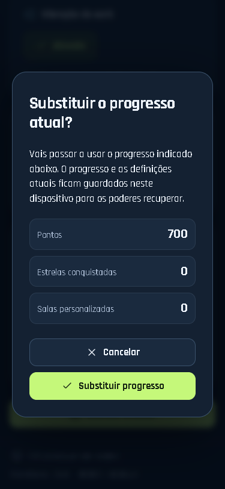

<!-- Copyright (c) 2026 p-darksy-r. BrandGame. -->
# Progresso e recordes

A versão 3.3.0 introduz `progressSchema: 2`. A normalização conserva os pontos acumulados, níveis desbloqueados, definições e salas de versões anteriores. Os saves antigos não continham estrelas nem resultados individuais: esses resultados ficam desconhecidos até voltares a jogar, com uma indicação no menu e nos níveis.

Na 3.4.0, `language` e `theme` guardam as preferências da interface no mesmo perfil. Saves sem estes campos recebem português de Portugal (`pt-PT`) e Meia-noite (`midnight`), sem reiniciar o progresso. Línguas ou temas desconhecidos são normalizados para estes valores. As alternativas são `en`/`es` e `light`/`forest`/`amethyst`.

`levelResults` guarda por categoria, número do nível e dificuldade: tentativas, conclusões aprovadas, melhores estrelas, melhor pontuação e menor tempo de jogo numa conclusão aprovada. `customResults` guarda o equivalente por identificador de sala; salas antigas sem ID usam um identificador derivado da posição existente. As melhores pontuações e os melhores tempos são métricas independentes e podem vir de partidas diferentes.

- Menos de 75% de acertos, ou partida não concluída: zero estrelas.
- Pelo menos 75%: uma estrela.
- Pelo menos 90%: duas estrelas.
- Todos os acertos: três estrelas.

O HUD soma o melhor número de estrelas de cada nível/sala, contando cada um apenas uma vez entre dificuldades. Criar uma sala não atribui estrelas. Uma repetição pior ou uma derrota não apaga um recorde anterior. Os pontos acumulados continuam a somar conclusões aprovadas, como nas versões anteriores; não são apresentados como se fossem o recorde do nível.

O tempo registado soma as rondas e exclui carregamento do logótipo, pausas e espera nos painéis de resposta. A gravação da conclusão é protegida contra chamadas repetidas. Campos inválidos de saves são normalizados e limitados antes de serem usados na interface.

## Cópias portáteis (3.6.0)

O ficheiro exportado nas definições inclui o conteúdo da gravação e identifica o formato e a sua versão. Podes guardá-lo localmente ou transportá-lo para outro dispositivo. Os nomes e pistas que escreveste nas salas fazem parte da cópia.

A importação valida o ficheiro antes de mostrar um resumo. Cancelar deixa a gravação atual como estava. Confirmar substitui o progresso completo, incluindo as preferências de língua e tema. O jogo guarda o progresso anterior para o poderes recuperar no mesmo perfil. Para conservar várias versões, guarda os ficheiros exportados separadamente.

